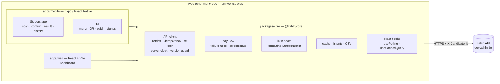
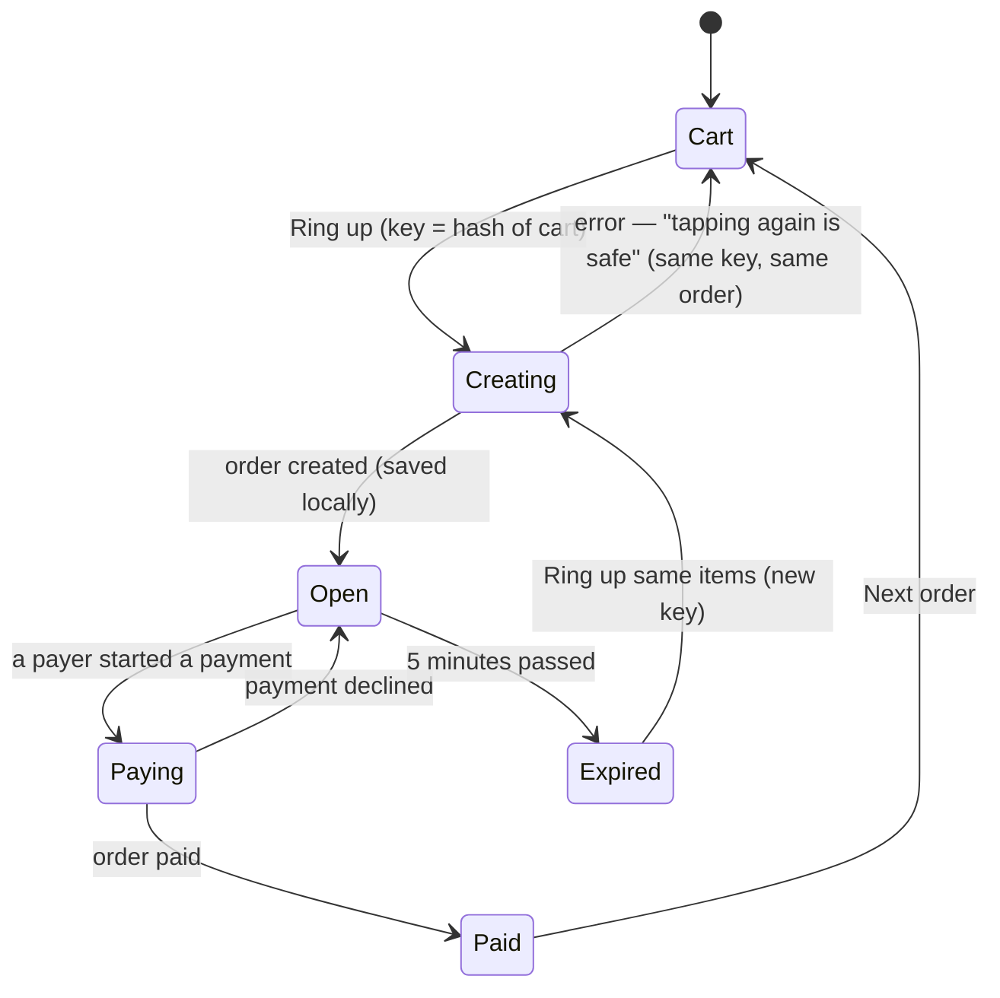

# Zahln Mensa — design document

One payment flow on three surfaces: the **student app** (phone), the **till** (tablet) and the **Studierendenwerk dashboard** (web). The guiding rule comes from the brief: *the client never causes money to move twice, and no screen shows a result that is not true.* Every decision below is measured against that rule first, and against speed on a low-end phone second.

---

## 1. Architecture

**What is shared** (everything that decides about money or truth lives in `@zahln/core`, written once and tested once):

| Shared in `@zahln/core` | Why it must be shared |
|---|---|
| API client (`client.ts`, `endpoints.ts`) | One implementation of retries, Idempotency-Key handling, unknown-outcome detection, 401 re-login and the version guard. Two copies would drift. |
| Types (`types.ts`) | Orders, payments, refunds and problems mirror `openapi.json`. |
| Pay rules (`payFlow.ts`) | `classifyPayFailure` decides whether a key is kept or dropped; `payScreen` turns (order, payment, time) into exactly one screen state. Pure functions, fully tested. |
| Intents and cache (`idempotency.ts`, `cache.ts`) | Same storage rules on every surface; the storage itself is injected. |
| i18n and formatting | German and English, one dictionary; a missing German string is a compile error. Euro and Berlin time formatting. |
| CSV | German-Excel CSV with formula-injection protection. |
| React hooks | Polling that never piles up requests, stale-while-revalidate cache. No DOM. |

**What is platform specific** is injected through `configureCore()`:

| | Web dashboard | App and till |
|---|---|---|
| Storage | `localStorage` | `expo-sqlite/kv-store` (synchronous, durable) |
| Random IDs | `crypto.randomUUID` | `expo-crypto` |
| App version | `package.json` | the installed APK's version (`expo-application`) |
| Language | saved choice → browser | saved choice → device locale |

The **student app and the till are one Expo app**. The role of the signed-in user picks the surface: payers get the student app, cashiers get the till. One binary halves build, signing and release work. Splitting it into two store listings later is a matter of two entry files.

There is no navigation or state library. Each surface has two tabs and at most one level of detail; a small `screen` state plus the Android back button is less code, less to load on a low-end phone, and easier to reason about than a router.

---

## 2. How a payment moves

### 2.1 On the phone

```mermaid
stateDiagram-v2
  [*] --> Loading: scan QR / deep link
  Loading --> Payable: order open
  Loading --> Expired: expired or past expiresAt (server time)
  Loading --> Paid: order paid (not by us)
  Loading --> BusyOther: order paying (other device)
  Loading --> LoadError: cannot read order

  Payable --> Confirming: tap Pay (remote config re-read first)
  Confirming --> Payable: cancelled / wrong PIN — nothing sent
  Confirming --> Sending: biometrics / device PIN / app PIN ok

  Sending --> Checking: 201 pending (payment id saved)
  Sending --> Checking: lost response, order shows our payment
  Sending --> Payable: lost response, no payment yet — "retry is safe" (same key)
  Sending --> Payable: amount_mismatch — new price shown, key dropped
  Sending --> Expired: order_expired
  Sending --> Payable: payments_disabled / app too old — key dropped

  Checking --> Confirmed: payment confirmed
  Checking --> Declined: payment declined
  Checking --> Checking: still pending — slower polling after 20 s,<br/>"do not pay again"

  Declined --> Payable: Try again (new key; only if order still open)
  Confirmed --> [*]
```

The rules behind it:

* **One key per intent.** The intent is *(user, order, amount)*. Its Idempotency-Key is created and **written to SQLite before the request leaves the phone**, and reused for every retry: the client's automatic retries, a tap on "Pay" after an unclear error, and a retry after the app was killed. A different amount (after `amount_mismatch`) is a different intent and gets a new key, which avoids `422 idempotency_mismatch`.
* **Unknown is not failure.** A 502, a 504, a timeout or a dropped connection after sending means *we do not know*. The app does not show "failed". It re-reads the order: if the order points at our payment, the app follows that payment; if not, it says the outcome is unclear and that paying again is safe, because the retry uses the same key.
* **The payment ID is saved with the key.** If the app dies after the server answered, the next time the same user opens the same order the app goes straight to "Checking your payment…". It never offers "Pay" again for that intent.
* **Only `confirmed` is paid.** "Paid" is shown only for *our own* payment with status `confirmed`. A pending payment that takes minutes shows "This is taking longer than usual. You do not need to do anything — please do not pay again".
* **Never go back in time.** Every order and payment passes through a version guard (`newest`, `pickNewer`). A late or out-of-order response with a lower `version` is ignored.
* **Server time.** Expiry countdowns use the `Date` header, not the phone's clock.
* **Sessions end mid-payment.** A 401 triggers one single-flight re-login, then the same request with the same key. A 401 means the server did nothing, so this is safe even for a payment.

### 2.2 On the till

* The till shows **"Paid" only when the order is `paid` on the server**. While a payment is being checked, the QR is dimmed and the till says "Wait for “Paid” before handing out the food".
* Ringing up uses an intent too: the same cart gives the same key, so a lost response followed by another tap returns the original order instead of a second one.
* The open order is saved on the tablet. If the till app restarts, it goes back to the same QR and keeps polling.
* **Refunds** use one key per *(payment, amount, reason)*. On an unknown outcome the button turns into "Retry refund — it will not refund twice". Server refusals (`refund_exceeds_payment`, `payment_not_refundable`, `refund_window_closed`) are shown in plain words. The form only allows amounts up to `refundableAmountCents`. A refund is watched until the server shows it `completed` or `failed`; a stale read that does not list it yet does not end the watch.

### 2.3 What goes wrong, and what the user sees

| Situation | Phone | Till |
|---|---|---|
| 503 before anything happened | automatic retry with backoff, then "busy, try again" | same |
| Response lost (502/504/timeout/drop) | re-read order → follow our payment, or "unclear — retry is safe" | "tapping again is safe" |
| Duplicate response / replay | `Idempotent-Replayed: true`; same payment shown | "refund had already been submitted" |
| Out-of-order or stale read | ignored by the version guard | ignored |
| Token expired | silent re-login, request repeated | same |
| Payment pending for minutes | "do not pay again", slower polling | QR dimmed, "wait for Paid" |
| Declined | "You were not charged", retry only if the order is still open | back to QR, payer can try again |
| Price changed | new amount shown, confirm again | — |
| Order expired | "ask the cashier to ring it up again" | "Ring up the same items again" |
| Payments switched off / app too old | Pay disabled with the reason; the switch is re-read right before every payment | — |
| App killed mid-payment | on reopen: "We found a payment you started earlier and are checking it" | open order restored |
| No network | last saved menu, history and totals shown and marked as offline; nothing that moves money is queued offline | same |

---

## 3. Shipping an app that cannot be hotfixed

A payment app on a student's phone stays in the field for months. The bug you ship is the bug you live with, so the release process has to make bad releases rare, small and stoppable.

1. **Two server-side switches, already wired.** `GET /config` returns `paymentsEnabled` and `minAppVersion`. The app reads them at start, caches them, and **re-reads them right before every payment**. Switching payments off, or forcing an update of a broken version, takes effect on the next tap with no release.
2. **Version discipline.** `X-App-Version` is sent with every request, so the server can refuse a broken version (`app_version_unsupported`) even if the config fetch is blocked. `versionCode` increases on every build; semantic versions are what `minAppVersion` compares.
3. **Staged rollout.** Internal track (team phones, a few tills) → closed track at one mensa → Play staged rollout 1 % → 10 % → 50 % → 100 %, with crash-free rate and payment success rate per app version as the gates. Halting the rollout is the first lever; `minAppVersion` is the second.
4. **Over-the-air updates for JavaScript only, and carefully.** EAS Update can replace the JS bundle without a store release. It is useful for copy and layout fixes, but every OTA bundle is pinned to a runtime version, ships through the same staged channels, and is never used to change payment logic without the same review as a store release.
5. **Backward-compatible API.** The server must keep serving the oldest supported app version. New fields are additive; the client ignores unknown fields and unknown problem codes (it shows the server's `detail`).
6. **Feature flags** for new flows, off by default, enabled per mensa from the config.
7. **Release checklist** run on a real low-end device: pay with each price group, pay while switching flight mode on and off, kill the app during "Checking…", decline then retry, refund partly, expire an order, switch payments off.

---

## 4. Security and data protection on the device

| Concern | What the app does |
|---|---|
| Access token | Kept in memory only. Never written to disk. Lost when the app is closed. |
| Password | Kept in memory only, so the app can log in again when the 5-minute token ends. Never written to disk or logs. (A refresh token from the API would remove this; see §6.) |
| Payment confirmation | System biometric prompt with the phone's own PIN or pattern as fallback. The app never sees a fingerprint or the phone's PIN. Phones without any screen lock use a 4-digit **app PIN**, stored only as a salted SHA-256 hash in `expo-secure-store` (Android Keystore), per user. 5 wrong tries delete it and sign the user out. |
| Data at rest | SQLite holds only idempotency keys (random UUIDs, order and payment IDs) and the offline cache (menu, own payments, config). The cache is scoped to the signed-in user and **wiped on logout**, which matters on a shared till. `android:allowBackup=false` keeps it out of cloud backups. |
| Permissions | Camera only. Microphone and overlay permissions are blocked in the manifest. |
| QR codes | Only `zahln://pay?order=ord_…` (and the same as an https link) is accepted. Any other QR code — a URL on a poster, Wi-Fi credentials — is rejected and never opens a payment screen. |
| Transport | HTTPS only; no cleartext traffic in release builds. |
| Signing | The release APK is signed with an upload key kept outside the repository (`~/.gradle/gradle.properties`). |
| Dashboard | Session in `sessionStorage` (gone when the tab closes), finance role only, cache cleared on logout. Firebase Hosting sends a strict Content-Security-Policy, `X-Frame-Options: DENY`, `Referrer-Policy: no-referrer`. CSV cells that start with `= + - @` are escaped so a payer name cannot run as a spreadsheet formula. |
| Personal data | The app stores no names, e-mails or card data. Payer names appear only in screens and CSV files the finance team is entitled to. No analytics SDK. |

Not done yet, and what I would add: `FLAG_SECURE` on the payment screens (no screenshots in the app switcher), certificate pinning once the production certificate chain is known, root and emulator signals sent to the server as risk input (not as a hard block), and crash reporting (Sentry) with PII scrubbing.

---

## 5. Technology choices

| Choice | Why |
|---|---|
| **Expo SDK 58 / React Native 0.88**, Hermes, New Architecture | What the brief asks for. Config plugins keep the native projects generated (`expo prebuild`), so there is no hand-edited Android code to maintain. |
| `expo-sqlite/kv-store` | **Synchronous**, durable writes. The Idempotency-Key must be on disk *before* the request leaves; AsyncStorage's write-behind could lose it if the app is killed. |
| `expo-local-authentication`, `expo-secure-store`, `expo-crypto` | System biometrics with device-credential fallback; Keystore-backed storage; secure random UUIDs. |
| `expo-camera` | QR scanning with ML Kit; only `qr` codes are decoded. |
| `react-native-svg` + `qrcode` | The till QR is drawn as **one SVG path** instead of hundreds of views, which keeps a cheap tablet smooth while it polls. |
| No navigation / state library | Two tabs and one detail level per surface. Fewer dependencies, smaller bundle, faster start. |
| React 19 + Vite for the dashboard | Fast builds, no server needed; hosted on Firebase Hosting. |
| Vitest, Testing Library, Playwright, Maestro | Unit tests for the rules, component tests for the dashboard, end-to-end against the live test server for web, device flows for the app. |

**What I would change about the stack in the brief:**

* The till does not need to be React Native. It is a kiosk on a fixed tablet; a web app in a locked-down browser (or a PWA) would share even more code with the dashboard and update instantly — the "cannot be hotfixed" problem disappears for the till. I kept it in Expo because the brief asks for it and because the camera, keep-awake and haptics are easier there.
* Polling for the till's "Paid" is the right default on a campus network, but the API should offer a push channel (see below) so the till learns about a payment in under a second without polling every second.

---

## 6. What the API is missing, and what I would change

Ordered by impact on correctness.

1. **No way to cancel an order.** When the cashier taps "Cancel & start a new order", the old order stays open for up to 5 minutes, and a student who already scanned it can still pay it — money for food that was never handed out. The app cannot prevent this. **Add `POST /orders/{id}/cancel`** (refused once a payment exists), and have the till cancel abandoned orders.
2. **No way to ask "did my payment request arrive?".** After a lost response the client can only re-read the order and hope it points at the payment. After a *decline* the order is freed, so an earlier attempt is invisible. **Add `GET /payments?idempotencyKey=…`** (scoped to the caller), or return the existing payment in the body of `409 order_payment_in_progress`.
3. **The server cannot verify that the user confirmed.** Biometrics happen on the phone; the server only sees a token. **Bind a device key** (passkey/WebAuthn-style, created in the Keystore at enrolment) and require a signature over *(order, amount, idempotency key)* on `POST /orders/{id}/payments`.
4. **No refresh token.** A 5-minute access token forces the app to keep the password in memory to survive a lunch rush. **Add refresh tokens** bound to the device, revocable from the server.
5. **No push for status changes.** The till polls every 1–1.5 s. **Add Server-Sent Events** (or a long-poll with `If-None-Match`) on `GET /orders/{id}`, and `ETag`/conditional GETs everywhere to save battery and data on slow networks.
6. **`503` without `Retry-After`.** The client guesses its backoff. A `Retry-After` header would let it back off exactly as long as the server needs.
7. **No server-side export.** The CSV export pages through `GET /payments` 200 rows at a time and stops at 10 000 rows. **Add `GET /reports/payments.csv?from=&to=`** (streamed, with the same filters).
8. **Daily totals use an implicit time zone.** The `date` parameter does not say it means Europe/Berlin. Make the zone explicit, and allow ranges (`from`/`to`) for month-end reports.
9. **Remote config is too thin to act on.** `minAppVersion` should be per platform and come with an update URL and a message; `paymentsEnabled` should come with a reason the app can show, and could be per mensa.
10. **No till-side order list.** After a crash the till relies on its local copy of the open order. `GET /orders?tillId=&status=open` would let it recover even from a wiped tablet.

---

## 7. What is left out, and why

* **iOS build.** The code is cross-platform and `supportsTablet` is set, but the brief asks for Android and I had no time to test on an iPhone.
* **Crash reporting.** Designed above (Sentry with PII scrubbing, release health as a rollout gate) but not wired, to avoid shipping an SDK and DSN in a take-home.
* **Offline payments.** Deliberately not built. Queuing a payment while offline and sending it later would break "never show a result that is not true" and is a different product (stored value on the device).
* **Push instead of polling.** Needs the API change in §6.5.
* **Store-ready release pipeline.** The APK is signed with an upload key and built locally; the CI workflow typechecks, tests and builds the web app. EAS Build and Play tracks are described in §3, not set up.
